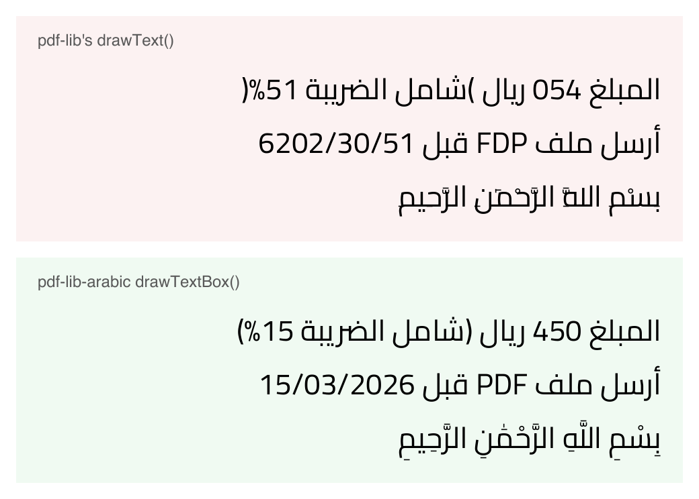

# pdf-lib-arabic

Write Arabic, Persian and Hebrew with [pdf-lib](https://github.com/Hopding/pdf-lib) the way a browser would show it, and keep the text selectable and searchable in the PDF.



Same font (Cairo), same three lines. Top: pdf-lib's own `drawText`. Bottom: this package.

## Install

```sh
npm install pdf-lib-arabic pdf-lib@1.17.1
```

## Example

```js
import { readFile, writeFile } from 'node:fs/promises';
import { PDFDocument } from 'pdf-lib';
import { drawTextBox, embedTextFont } from 'pdf-lib-arabic';

const doc = await PDFDocument.create();
const page = doc.addPage();
const font = await embedTextFont(doc, await readFile('Cairo-Regular.ttf'));

drawTextBox(page, font, 'المبلغ 450 ريال (شامل الضريبة 15%)', { x: 50, y: 760, width: 495, size: 18 });
await writeFile('out.pdf', await doc.save());
```

`x` is the left edge of the box and `y` the baseline of its first line, the same point pdf-lib's `drawText` uses. Text wraps at `width`, and right-to-left lines start at the box's right edge. To add text to an existing PDF, load it with `PDFDocument.load(bytes)` and draw on one of its pages the same way. In the browser, pass the font as an `ArrayBuffer` from `fetch`.

You need a font with Arabic (or Hebrew) glyphs. See [Fonts](#fonts) for the ones we tested.

## What it does

- Runs the Unicode Bidirectional Algorithm ([bidi-js](https://github.com/lojjic/bidi-js)) on each paragraph. A paragraph takes the direction of its first strong character, like a textarea with `dir="auto"`, unless you pass `direction: 'rtl'` or `'ltr'`.
- Breaks lines on the logical text by measured width, then reorders each line for display and mirrors brackets.
- Shapes every bidi run with [fontkit](https://github.com/Hopding/fontkit) in an explicit direction, so a run of Arabic-Indic digits like `٤٥٠` isn't laid out backwards.
- Places each glyph where fontkit puts it, mark offsets included, so harakat sit on their letters.
- Writes a ToUnicode entry for every glyph. Ligatures that stand for several letters, like لا, are stored so viewers copy لا and not ال.
- Handles ZWNJ and ZWJ (Persian می‌خواهم), and the RLM and LRM marks that text pasted from WhatsApp or Word often carries.
- Takes a font stack: Arabic from one font, Latin or symbols from the next one that has them.
- Aligns `start`, `center` or `end` relative to each line's direction, and keeps text upright on rotated pages (`uprightTransform`).
- Tells you before drawing when no font has a character: `layoutText(...).missing`, or a `MissingGlyphsError` with the characters.

## What it doesn't do

- Justify text (no kashida), hyphenate, or set vertical text.
- Edit or replace text that's already in a PDF. It draws new text.
- Fall back to fonts you didn't pass. Emoji and colour glyphs aren't supported.
- Fix copy and paste for every font. Fonts that build letters from a dotless shape plus separate dots look right but copy badly, because a PDF maps each glyph to one character (ع and غ share a shape). Some viewers, pdf.js and poppler among them, also copy a mirrored bracket inside right-to-left text.
- Shaping for scripts other than Arabic. Hebrew needs only bidi, which works. Indic and Southeast Asian scripts are untested.

## Fonts

Tested on 2026-11-12 with each font's current file from Google Fonts (all SIL Open Font License), drawing a price with digits, a line with harakat and lam-alef, and Persian:

| Font | pdf-lib 1.17.1, `@pdfme/pdf-lib` | `@cantoo/pdf-lib` | Copy and search |
|---|---|---|---|
| Cairo | ✅ | ✅ | ✅ |
| IBM Plex Sans Arabic | ✅ | ✅ | ✅ |
| Vazirmatn | ✅ | ✅ | ✅ |
| Almarai | ✅ | ✅ | ✅ |
| Tajawal (no Persian letters or digits) | ✅ | ✅ | ✅ |
| Noto Sans Arabic, 2022 static build | ✅ | ✅ | ✅ |
| Amiri | ❌ broken by the subsetter | ✅ | ✅ (pdf.js splits ريال) |
| Noto Naskh Arabic | ❌ broken by the subsetter | ✅ | ❌ dotless shapes |
| Noto Sans Arabic, current build | ✅ | ✅ | ❌ dotless shapes |
| Noto Kufi Arabic | ✅ | ✅ | ❌ dotless shapes |

"Broken by the subsetter" means pdf-lib 1.17.1's font subsetter (`@pdf-lib/fontkit` 1.1.1) writes a font with missing outlines. Plain `drawText` with `{ subset: true }` breaks the same way. `@cantoo/pdf-lib` ships a newer subsetter. Only TrueType outlines (`.ttf`) were tested.

## pdf-lib versions

The package needs **pdf-lib 1.17.1**, the last release. To place glyphs one by one it uses four internals of pdf-lib's font subsetter. They're checked when you embed a font, and a test fails if they move.

It also works with two maintained forks. Import from the matching entry point so the PDF operators come from the same package as your page:

| You use | Import from | Notes |
|---|---|---|
| `pdf-lib` 1.17.1 | `pdf-lib-arabic` | |
| `@pdfme/pdf-lib` 6.2.8+ | `pdf-lib-arabic/pdfme` | |
| `@cantoo/pdf-lib` 2.11.1+ | `pdf-lib-arabic/cantoo` | Register `@cantoo/fontkit` on the document first, as cantoo's docs say. |

CI runs the whole test suite against both forks.

## API

- `embedTextFont(doc, fontBytes)` embeds a TrueType font as a subset and returns `{ pdfFont, font }`. Call it once per document and font. It uses the fontkit registered on `doc`, or `@pdf-lib/fontkit` if there's none.
- `drawTextBox(page, fontOrFonts, text, options)` lays the text out and draws it. Options: `width` (required), `size` (required), `x`, `y`, `align`, `direction`, `fallbackDirection`, `lineHeight` (default 1.6), `color`, `transform`. Returns the layout.
- `layoutText(fontOrFonts, text, { size, maxWidth, direction, lineHeight })` gives lines, glyph positions, `width`, `height` and `missing` without touching a PDF. Pass `createLayoutFont(bytes)` fonts, or the `font` from `embedTextFont`.
- `drawLayout(page, embeddedFontOrFonts, layout, options)` draws a layout you already have, for example the one you used for an on-screen preview.
- `uprightTransform(x, y, rotation)` keeps text upright on a page with `/Rotate`. Pass it as `transform`.
- `MissingGlyphsError` lists the characters no font could draw.

## Why pdf-lib's drawText gets it wrong

`drawText` hands the whole string to fontkit, which sees Arabic and lays the run out right to left, digits and Latin included. pdf-lib then places the glyphs by advance width only, so the offsets that put harakat on their letters are lost. That's [pdf-lib#1450](https://github.com/Hopding/pdf-lib/issues/1450). This package runs bidi first, shapes each run in its own direction, and writes every glyph at its own position.

## Where it comes from

This is the text engine of the PDF editor at [BlendPDF](https://blendpdf.com/edit-pdf?utm_source=github&utm_medium=readme&utm_campaign=oss-launch&utm_content=pkg), taken out as a library and released under MIT (the site's own code is AGPL-3.0). With one font it writes byte for byte what the site writes. The tests are its golden corpus: real form fields, prices, dates and contract clauses, each written to a PDF and read back with pdf.js to check glyph order on the page and that every word can be found.

## License

MIT. The fonts in `test/fonts` are under the SIL Open Font License, with their licence files next to them. They're test fixtures and aren't in the npm package.
